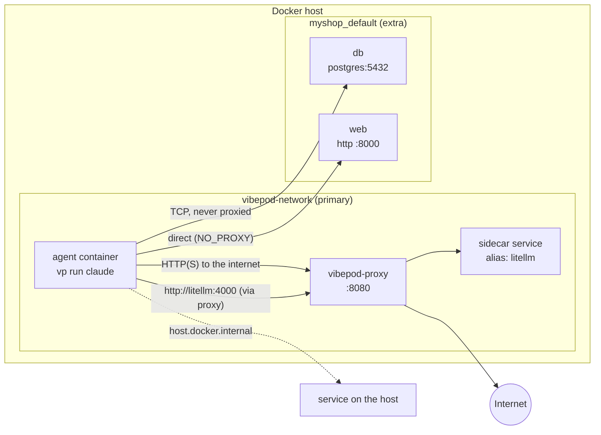

# Connecting to other containers

Agents often need to reach services that run next to them: the project's
database, a dev server started with `docker compose up`, a model gateway.
This page explains how an agent container is wired to the networks those
services live on, how requests travel, how to run commands against those
services, and what to check when a connection fails.

## How it fits together

Every agent container joins one **primary** network and, optionally, one
**extra** network:

- **Primary network:** the network named by the `network:` config key,
  `vibepod-network` by default. VibePod creates it on first use. The agent and
  the built-in `vibepod-proxy` both join it, and so does any service you attach
  on purpose (see [Integrating external tools](integrations.md#services-on-the-vibepod-network)).
- **Extra network:** an existing network, usually the `<project>_default`
  network of a compose project. It is chosen with `--network` or from the
  compose prompt. Only the agent joins it.



Ways to reach a service:

| Service runs… | Address from the agent | Setup |
|---|---|---|
| In a compose project of the workspace | `db:5432`, `http://web:8000` (compose service names) | Answer the compose prompt, or pass `--network <project>_default` |
| In any container on another network | Container name or network alias | `--network <name>` |
| On the VibePod network | Its alias, e.g. `http://litellm:4000` | Join `vibepod-network` as an external network ([recipe](integrations.md#services-on-the-vibepod-network)) |
| On the host itself | `host.docker.internal:<port>` | None: every agent gets this host-gateway mapping. Bind the service to an address the bridge can reach |

## What `vp run` does, step by step

1. **Ensure the primary network.** `vibepod-network` (or your `network:`
   value) is created when it is missing.
2. **Pick the extra network.** `--network` wins. Without it, if the workspace
   has a `compose.yaml`, `compose.yml`, `docker-compose.yaml` or
   `docker-compose.yml`, VibePod lists the networks that have running
   containers (minus the primary network and `bridge`/`host`/`none`) and asks
   whether to join one. Networks of the workspace's own compose project (the
   `<project>_` prefix, from `COMPOSE_PROJECT_NAME` or the directory name) come
   first, so the default answer is usually right. Without a TTY the prompt is
   skipped with a warning. Under `--acp` the editor shows the question as a form
   instead.
3. **Start the proxy.** `vibepod-proxy` is provisioned on the primary network,
   and the agent gets `HTTP_PROXY`/`HTTPS_PROXY` pointing at it plus
   `NO_PROXY=localhost,127.0.0.1,::1`.
4. **Exempt the extra network from the proxy.** The proxy is not on the extra
   network and cannot resolve its names. VibePod therefore appends the names
   and aliases of the containers on that network to `NO_PROXY` (and to
   `no_proxy` if you set it), and prints the list:
   `Bypassing proxy for hosts on myshop_default: db, myshop-db-1, myshop-web-1, web`.
5. **Start the agent** on the primary network.
6. **Connect the extra network.** It is attached once the container is running.
   If that fails, for example because the network does not exist, VibePod
   prints a warning and the agent keeps running without it.

`vp task create --network <name>` and `vp board work --network <name>` follow
the same steps but never prompt. The extra network has to be named
explicitly.

## Typical invocations

```bash
# Compose project in the workspace: start it, then answer the prompt
docker compose up -d
vp run claude
#   Compose file detected. Connect this container to a network with running containers? [y/N]: y
#   1. myshop_default
#   2. litellm_default
#   Select a network [1/2] (1):

# Name the network up front (scripts, CI, no prompt)
vp run claude --network myshop_default

# Headless task against the same services
vp task create claude "run the integration tests against db" --network myshop_default

# Board workers: every agent run joins the network
vp board work --network myshop_default
```

Find the network name with `docker network ls` or
`docker compose ps --format '{{.Networks}}'`.

## Running commands against other containers

An agent container has **no access to the Docker socket**, so `docker exec`
and `docker compose run` do not work from inside it. Talk to services over
the network instead:

```bash
# inside the agent, after joining myshop_default
psql -h db -U postgres -c 'select 1'
redis-cli -h cache ping
curl -fsS http://web:8000/health
```

Client tools that are missing from the agent image can be installed with a
[project overlay](overlays/index.md), so they are there on every run:

```dockerfile
# .vibepod/overlay/Dockerfile — no FROM line
RUN apt-get update \
 && apt-get install -y --no-install-recommends postgresql-client redis-tools \
 && rm -rf /var/lib/apt/lists/*
```

A command that has to run *inside* the service container, such as a Django
`manage.py` or a Rails console, can be offered over HTTP or SSH by that
service, or run by you on the host with `docker compose exec`.

!!! danger "Do not mount the Docker socket"
    `volumes: ["/var/run/docker.sock:/var/run/docker.sock"]` would let the
    agent run `docker exec`. It also gives the agent root-equivalent control
    of the host and bypasses every VibePod isolation layer, the proxy filter
    included. Prefer network clients. If you do need container control, use a
    socket proxy that allows only the calls you need, such as
    [docker-socket-proxy](https://github.com/Tecnativa/docker-socket-proxy).

## Troubleshooting

| Symptom | Cause | Fix |
|---|---|---|
| `Could not resolve host: db` | The agent is not on the service's network | Check that `Connected to additional network: …` was printed. Pass `--network` explicitly. On Podman, use a DNS-enabled network ([Quickstart](quickstart.md#using-podman-instead-of-docker)) |
| `502 Bad Gateway` or a proxy error for `http://web:8000` | The request went through `vibepod-proxy`, which is not on the extra network. Usually the service started after the agent, so its name is missing from `NO_PROXY` | Start services before the agent, or run with `-e NO_PROXY=localhost,127.0.0.1,::1,web` |
| HTTP to a sidecar on `vibepod-network` is blocked | Proxy filter in `allow` mode | `vp proxy filter allow add <alias>` |
| `Failed to connect to network …: 404` | Network name typo, or the compose project is down | `docker network ls`, then `docker compose up -d` |
| No compose prompt appears | No running containers on a non-primary network, no TTY, or the compose file has a non-default name | Start the services, or pass `--network` |
| `Connection refused` on a host service | The service listens on `127.0.0.1` only | Bind it to the bridge gateway or `0.0.0.0` (see [LLM integration](llm.md)) |

Commands to check from inside the agent: `getent hosts db` (DNS),
`env | grep -i proxy` (proxy routing), `nc -zv db 5432` (TCP reachability).

## Known limitations and planned improvements

These are the remaining gaps in the flow, each with a proposed fix:

1. **The `NO_PROXY` list is taken at start.** Services started or recreated
   after the agent are still routed through the proxy. *Proposal:* also attach
   `vibepod-proxy` to the extra network so it can reach those services. This
   keeps traffic logged in `vp logs`, but every container on that network
   could then reach the proxy, so it should be opt-in.
2. **A mistyped `--network` only warns.** The network is connected after
   start, so the agent runs without it. *Proposal:* check that the network
   exists before creating the container, and fail with the list of available
   networks.
3. **Only one extra network.** *Proposal:* make `--network` repeatable and
   add a project-level `networks:` key in `.vibepod/config.yaml`, so
   `vp task` and board runs pick up the right network without a flag.
4. **No readiness check.** The agent can start before the database accepts
   connections. *Proposal:* an optional `wait_for: ["db:5432"]` setting that
   probes the listed TCP endpoints before handing over to the agent.
5. **The prompt only names networks.** *Proposal:* show the containers on each
   network so the right choice is obvious when several projects are running.
