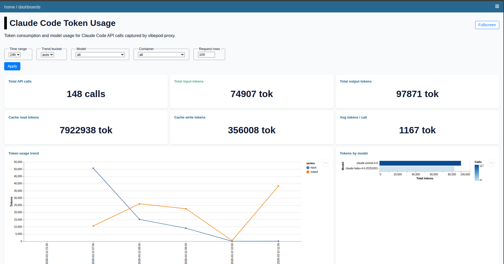

# Compare two agents on the same task

In this tutorial you give Claude and Codex the same small task in the same
project, then compare what each one changed and how much traffic it produced.
You will use:

- [Task mode](../agents/index.md#task-mode-headless) to run each agent
  headlessly with an identical prompt
- Git worktrees, so the agents work on separate copies and cannot overwrite
  each other's changes
- The [session log UI](../quickstart.md#view-the-session-log-ui) (`vp logs start`)
  to compare their HTTP traffic and token usage

Any two agents that support task mode work the same way; see the
[supported agents table](../agents/index.md#supported-agents-v1).

## 1. Log in to both agents

Task mode reuses the credentials each agent stored on a previous run, so log
in once interactively if you have not already:

```bash
cd ~/my-project
vp run claude          # log in, then exit
vp run codex login     # browser OAuth for Codex
```

See [Agents > First run & authentication](../agents/index.md#first-run-authentication)
for the details of each agent, and
[Codex task authentication](../agents/index.md#codex-task-authentication) if
you prefer to pass an API key to Codex instead.

## 2. Create one copy of the project per agent

Both agents edit files in their workspace. To keep their results apart, give
each one its own Git worktree, created from the same commit:

```bash
cd ~/my-project
git worktree add -b compare/claude ../my-project-claude
git worktree add -b compare/codex ../my-project-codex
```

VibePod asks before it runs an agent in a directory for the first time. To
answer that question up front, add both worktrees to the allow list:

```bash
vp config allow-dir ../my-project-claude
vp config allow-dir ../my-project-codex
```

## 3. Start the dashboard

Start the Datasette UI now so you can watch requests arrive while the agents
work:

```bash
vp logs start
```

This starts the `vibepod-datasette` container on port `8001` (configurable
via `logging.ui_port` or `--port`) and opens the dashboards page in your
browser. Use `--no-open` to skip opening the browser.

## 4. Run the same prompt with both agents

Store the prompt in a shell variable so both agents get exactly the same text,
then start one task per worktree:

```bash
PROMPT="Add a short CONTRIBUTING.md that explains how to run this project's tests."

vp task create claude "$PROMPT" -w ../my-project-claude --ikwid --timeout 30m
vp task create codex "$PROMPT" -w ../my-project-codex --ikwid --timeout 30m
```

Each command starts a detached container and prints a task id, roughly like
this (ids and names differ):

```text
Task started: 9f1e8a20b4c14e2f89d7f6a1c3e42b99
  container: vibepod-claude-abcdef12
  timeout:   30m (1800s)
  follow:    vp task logs 9f1e8a20b4c1 --follow
```

!!! note "Why `--ikwid`?"
    A headless task cannot answer permission prompts. `--ikwid` adds each
    agent's own auto-approval flag so it can edit files without asking (see
    [Auto-approval for automation](../agents/index.md#auto-approval-for-automation)).
    The agent then acts without confirmation inside its container, so only use
    it on a workspace you are prepared to discard, like these worktrees.

The two tasks are independent containers; VibePod does not coordinate or
schedule them. They share the VibePod proxy, which records each request
together with the container and agent that sent it.

## 5. Follow the tasks

```bash
vp task list                    # both tasks with their status
vp task logs <id> --follow      # stream one agent's output
vp task status <id>             # state, exit code, and timestamps
```

Task ids can be shortened to any unique prefix, such as the 12 characters
shown by `vp task list`.

## 6. Compare the results

When both tasks show a finished status, compare what each agent changed:

```bash
git -C ../my-project-claude status --short
git -C ../my-project-codex status --short

git -C ../my-project-claude diff
git -C ../my-project-codex diff
```

New files show up as untracked (`??`) in `git status`. To see the final text
the agent printed, use `vp task logs <id>`.

## 7. Compare traffic and tokens in the dashboard

Switch to the browser tab opened by `vp logs start`
(`http://localhost:8001/-/dashboards`). Requests from both agents went through
the same proxy, and each is attributed to the container that sent it, so you
can filter by container to compare the agents side by side.

The Claude Code token usage dashboard shows API calls, input/output tokens,
cache usage, and tokens per model for Claude Code requests, with a
**Container** filter:



Token figures depend on what the dashboard can read from a provider's API
responses. For agents without a token dashboard, compare their request counts
and traffic instead.

## Where the data lives

Everything stays on your machine. Print the paths in use with:

```bash
vp config path
```

| Data | Default location |
| ---- | ---------------- |
| Session log (interactive `vp run` sessions) | `~/.config/vibepod/logs.db` (`logging.db_path`) |
| Proxied HTTP traffic | `~/.config/vibepod/proxy/proxy.db` (`proxy.db_path`) |
| Task records | `~/.config/vibepod/tasks.db` |
| Task output | the stopped task container, read with `vp task logs <id>` |

The dashboard reads the session log and the proxy database. Task mode does not
write to the session log; only interactive runs without `--detach` do (see the
[detached mode caveats](../agents/index.md#caveats)).

!!! tip "Comparing interactive sessions instead"
    You can also run the agents interactively, one per terminal:
    `vp run claude -w ../my-project-claude` and
    `vp run codex -w ../my-project-codex`. Type the same prompt into both.
    These sessions also appear in the session log.

## Clean up

Task containers are kept after they finish so you can read their logs. Remove
the tasks, then stop the dashboard:

```bash
vp task rm <claude-task-id>
vp task rm <codex-task-id>
vp logs stop
```

`vp task rm --all` removes every recorded task, not just these two, and
refuses while any of them is still running unless you add `-f`. `vp stop --all` stops every
VibePod-managed container, including the proxy and the dashboard.

Finally, keep the branch you liked and remove the worktrees:

```bash
git worktree remove ../my-project-claude
git worktree remove ../my-project-codex
```

`git worktree remove` refuses to delete a worktree with uncommitted changes;
commit what you want to keep first, or add `--force` to discard it.

## Next steps

- [Task mode](../agents/index.md#task-mode-headless): timeouts, passing agent
  flags, and cancelling tasks.
- [Configuration > The built-in proxy](../configuration.md#the-built-in-proxy):
  how traffic is recorded, and how to restrict it with allow/deny filters.
- [Use your own model provider](own-model-provider.md): compare models as well
  as agents.
